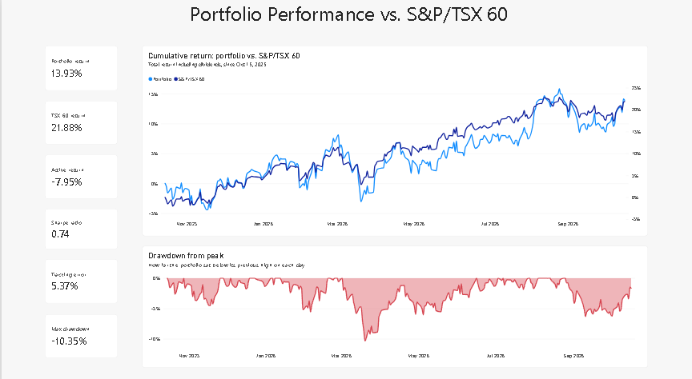
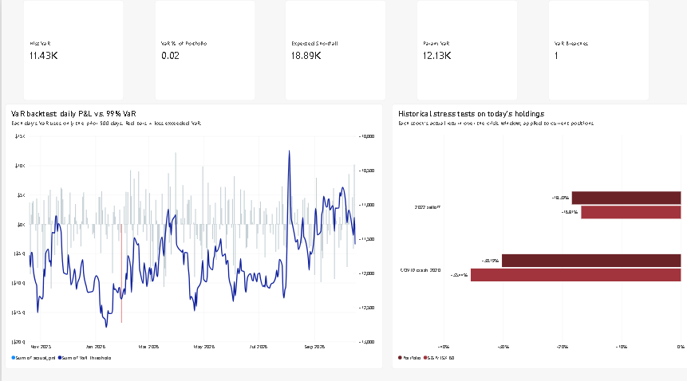
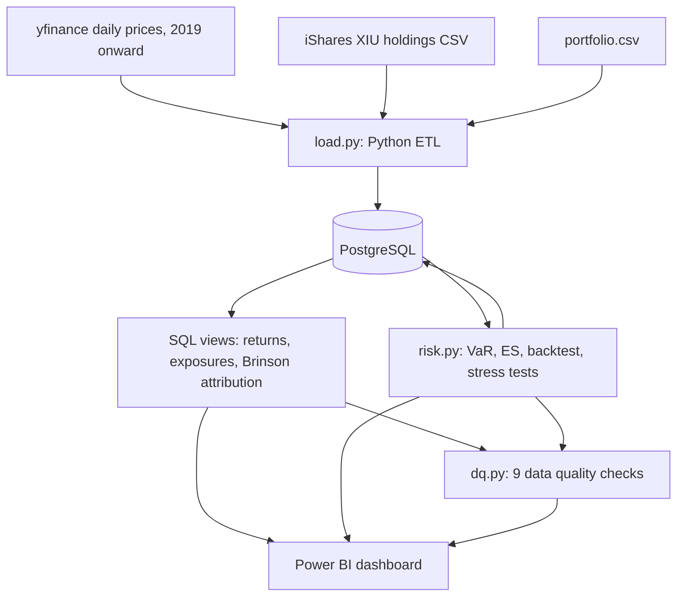

# Portfolio Performance Attribution & Risk Dashboard

A Python, PostgreSQL and Power BI pipeline that measures a Canadian equity portfolio against the S&P/TSX 60, explains the difference with Brinson attribution, and estimates downside risk with Value at Risk, expected shortfall, backtesting and historical stress tests. Automated data quality checks reconcile every result end to end.




*Please see Power BI for the rest


## Key results (12 months to October 16, 2026)

| Measure | Result |
| --- | --- |
| Portfolio vs. S&P/TSX 60 | 13.9% vs. 21.9% (−8.0 pts) |
| Brinson attribution (sum of daily effects) | Selection −4.7, allocation −1.9, interaction +0.3 pts |
| Largest detractor | Constellation Software, −2.5 pts of active return |
| Risk profile | Tracking error 5.4%, beta 1.19, Sharpe 0.74, information ratio −1.48 |
| One-day 99% VaR / expected shortfall | $11,430 (2.25%) / $18,892 (3.71%) on $508,815 |
| VaR backtest | 1 breach in 250 days vs. 2.5 expected (Basel green zone, Kupiec p = 0.28) |
| Stress tests on current holdings | COVID crash −30.2% vs. −35.4%; 2022 selloff −18.4% vs. −16.8% |
| Benchmark validation | Rebuilt benchmark 21.88% vs. XIU actual 21.85% |

Full write-up: [Portfolio commentary (PDF)](docs/commentary.pdf)

## What it answers

1. **Did we beat the benchmark?** Time-weighted returns, volatility, Sharpe ratio, tracking error, beta and drawdown versus the S&P/TSX 60.
2. **What bets are we making?** Sector and stock weights versus the benchmark, plus active share.
3. **Why did we win or lose?** Brinson-Hood-Beebower attribution by sector, and each stock's contribution to active return.
4. **How much could we lose?** Historical and parametric VaR, expected shortfall, a VaR backtest and historical stress scenarios.

## How it works



**Stack:** Python (pandas, NumPy, SQLAlchemy, yfinance), PostgreSQL, SQL window functions and materialized views, Power BI.

## Repository structure

```text
data/        xiu_holdings.csv, portfolio.csv
sql/         01_schema.sql, 02_performance.sql, 03_attribution.sql
src/         db.py, load.py, run_sql.py, risk.py, dq.py, run_all.py
powerbi/     dashboard.pbix
docs/        commentary.pdf, screenshots/
```

## Running it

Requirements: Python 3.10+, PostgreSQL 16+, Power BI Desktop (Windows).

1. Clone the repo, create a virtual environment, and run `pip install -r requirements.txt`.
2. Create a PostgreSQL database named `portfolio_risk`, and add a `.env` file with `DB_HOST`, `DB_PORT`, `DB_NAME`, `DB_USER` and `DB_PASSWORD`.
3. Create the tables: `python src/run_sql.py sql/01_schema.sql`.
4. Download the latest XIU holdings CSV from iShares into `data/xiu_holdings.csv`, and edit `data/portfolio.csv` to any set of TSX 60 stocks.
5. Run the full pipeline: `python src/run_all.py`. It stops at the first failed step, and exits with an error if any data quality check fails.
6. Open `powerbi/dashboard.pbix` and click **Refresh**.

## Methodology

- **Returns:** daily returns from dividend-adjusted closing prices; the portfolio holds fixed share counts from October 15, 2025, and cumulative returns compound in SQL as `EXP(SUM(LN(1 + r)))`.
- **Benchmark:** XIU's published weights are converted into implied share counts (weight ÷ price on the holdings date) and held, so benchmark weights drift with prices like the real index.
- **Attribution:** Brinson-Hood-Beebower by sector using previous-day weights. Allocation = (wₚ − w_b)(R_b,s − R_b), selection = w_b(Rₚ,s − R_b,s), interaction = (wₚ − w_b)(Rₚ,s − R_b,s).
- **VaR and ES:** historical 99% one-day VaR from 500 days of returns applied to current holdings; parametric VaR from the covariance matrix; expected shortfall as the average loss beyond VaR.
- **Backtest:** each of the last 250 days uses only the prior 500 days and the previous day's holdings, so there is no look-ahead. Results are scored against Basel traffic-light zones and the Kupiec proportion-of-failures test.
- **Stress tests:** crisis windows are detected from data as XIU's largest peak-to-trough decline within 2020 and 2022, then each stock's actual return over the window is applied to current positions.

## Validation

| Check | Result |
| --- | --- |
| Portfolio and benchmark weights sum to 100% | Pass (max deviation 8.9e-16) |
| Value-based and weight-based returns match | Pass (max daily gap 1.0e-15) |
| Brinson effects equal daily active return | Pass (max daily gap 9.5e-18) |
| Stock-level and sector-level attribution totals match | Pass |
| Rebuilt benchmark vs. XIU | Pass (gap 0.04 pts, tracking error 0.99%) |
| VaR backtest | Pass (Basel green zone) |
| Data freshness | Pass |
| Return outliers beyond ±25% | Warn: 9 days, all verified as real market events |
| Carried-forward prices | Warn: 1 stock-day |

## Data notes

- **Look-ahead bias caught by reconciliation:** the first benchmark applied end-of-period weights to the whole year and beat the actual XIU ETF by about 10 points. The benchmark-vs-XIU check flagged it, and the fix was to back out implied share counts.
- **pandas and National Bank:** pandas reads the ticker `NA` as a missing value by default, which would have silently dropped the stock. The loader disables default missing-value parsing and fails loudly on blank tickers.
- **Verified outliers:** flagged returns include Cenovus (−52%) and Canadian Natural (−29%) on March 9, 2020, during the oil price war; the March 24, 2020 rebound; and First Quantum (−28%) on October 30, 2023, after Panama announced a referendum on its Cobre Panama mine.

## Known limitations

- Current TSX 60 constituents are applied to the full history, so stocks that joined or left the index are not handled (survivorship bias).
- Implied benchmark share counts are fixed, while the real index updates them at quarterly rebalances.
- Multi-day attribution effects are summed rather than geometrically linked (for example, with the Carino method).
- The risk-free rate is an approximate 2.3% average of Canadian 3-month T-bill yields.
- VaR uses a one-day horizon and assumes the next day resembles the last two years; stress tests assume a stock without history in a window returned 0%.
- Prices come from Yahoo Finance via the unofficial yfinance library.

## Next steps

- Geometric linking of attribution effects
- Point-in-time index constituents
- Daily risk-free rate from the Bank of Canada Valet API
- Factor-based risk decomposition
